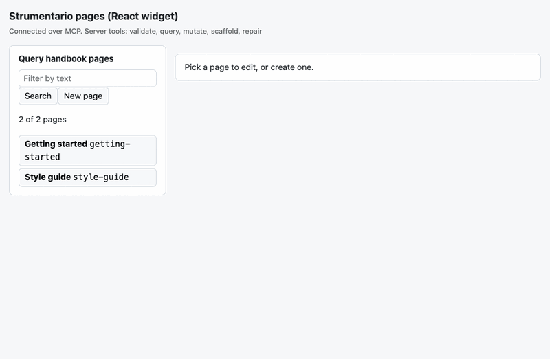

# Web component MCP App widget

`packages/widget` is the first human surface of Phase 3A: a vanilla web component (`<strumentario-page-widget>`, shadow DOM, no framework dependency) that lists pages, edits them with live validation, and saves through a dry-run preview. It is a view over the same MCP tools the CLI, the evals and the [AI SDK path](../../README.md#ai-sdk-path) call. There is no private API.



The recording is the local harness below, driven through a real browser against a real server; it is not an MCP Apps host (see [What is and is not verified](#what-is-and-is-not-verified)).

## What it does

| Step | MCP call | What the widget shows |
|------|----------|-----------------------|
| List | `query` (optional `text`) | Pages with the count out of `total` |
| Open | `query` with the key | The page at its current `revision`; the key (`slug`) is locked once a page exists |
| Edit | `validate` after a pause (250 ms) | The server's error strings, or "Valid."; stale answers are dropped |
| Preview | `mutate` with `dryRun: true` | A before/after table and "nothing written yet"; refused while the draft is invalid |
| Save | `mutate` with `dryRun: false`, `expectedRevision`, `idempotencyKey` | The new revision, and a refreshed list. Only enabled for a draft whose preview just succeeded |
| Conflict | the `conflict` error from `mutate` | The draft is kept, with a "Reload latest" button |

Editing again after a preview discards the preview, so what is saved is always what was previewed. Deleting pages is not part of the widget yet.

## Layers

```text
tool contracts (server)   toolContracts: JSON Schema, no framework
        │  src/generate.ts  (pnpm --filter @strumentario/widget generate)
        ▼
src/generated/contracts.ts   StoredPage, PageDraft, PAGE_FIELDS, KEY_FIELD,
                             Query/Validate/Mutate Input and Output, TOOL_META
        │
        ▼
src/controller.ts            framework-neutral state machine over a ToolCaller
        │  subscribe / getState / actions
        ▼
src/element.ts               <strumentario-page-widget> custom element (render only)
```

- **Prop types are generated, not copied.** `generate.ts` turns the server's `toolContracts` into TypeScript types and the editable field list. The editor renders its inputs from `PAGE_FIELDS`, so a field added in `packages/server/src/schema.ts` appears in the widget after regenerating. `generated.test.ts` fails when the checked-in file differs from what the contracts generate, when the widget's tools are not published over `tools/list`, or when the field list no longer matches the server's stored page.
- **The controller has no framework in it.** It takes a `ToolCaller` (`mcpToolCaller(client)` adapts any MCP client or host bridge with `callTool`) and exposes `getState()` and `subscribe()`. The element renders that state and forwards events. A custom element works as is inside Vue, Svelte, React 19 or plain HTML, so there are no per-framework widgets: see [Use the widget from a framework](frameworks.md). A native wrapper component (for example with Vue events and slots) would be a thin shell around the same element and is not built.
- **Presentation hints are not schema.** Which fields use a text area (`multilineFields`, default `["body"]`) is the element's `multiline-fields` attribute (comma-separated). `validate-delay-ms` sets the debounce.

## Run it

```bash
pnpm install
pnpm --filter @strumentario/widget harness        # http://127.0.0.1:3002/  (--port, --data-dir)
```

The harness serves the bundled widget and the Strumentario MCP endpoint from one origin, over a throwaway store seeded with two pages (a temp directory, removed on exit unless you pass `--data-dir`). The browser connects with the SDK's Streamable HTTP client and shows the tools the server published.

To use the widget elsewhere:

```ts
const client = new Client({ name: "my-host", version: "1.0.0" });
await client.connect(new StreamableHTTPClientTransport(new URL("http://127.0.0.1:3001/mcp")));
defineStrumentarioPageWidget();                       // registers <strumentario-page-widget>
document.querySelector("strumentario-page-widget").caller = mcpToolCaller(client);
```

If the server has bearer tokens set, pass them in the transport's `requestInit` headers; a read token can list and validate but its `mutate` calls are refused, and the widget shows the server's message.

## Headless

The same tools work with no UI. `src/headless.test.ts` starts the HTTP server, lets the widget controller and the `strumentario call` CLI take turns on one store (the CLI creates, the widget edits and saves, the CLI reads the edit back), and checks that `validate` returns the same verdict on both paths.

```bash
pnpm --filter @strumentario/server serve
pnpm --filter @strumentario/cli build
node packages/cli/dist/main.js call query --input '{"slug":"getting-started"}' --json
```

## Tests

`pnpm test` runs them with no secrets and no external network (an in-memory MCP transport, plus a loopback HTTP server for the headless test):

- `generated.test.ts`: the drift test described above, a domain with an extra field, a missing-contract error.
- `controller.test.ts`: list and filter; validate errors, debounce and stale answers; the preview-before-save rule; create; conflict; one idempotency key per draft.
- `element.test.ts`: the plain-DOM host of the shared suite: the whole flow through the rendered element (jsdom) against a real server, a check that typing keeps the same input element, focus and caret while live validation re-renders, editor fields from the contract, conflict with "Reload latest", and a failed list.
- `widget-behavior.ts`: the shared behavior suite behind `element.test.ts` and the two fixtures below. It is not a test file; each host calls it with its own way of mounting the element.
- `fixtures/vue-app` and `fixtures/svelte-app` (test fixtures, not published): the same suite with the element rendered by Vue and by Svelte, plus property passing, late registration (client-only) and, for Vue, server rendering. `pnpm typecheck` also type-checks both fixtures. See [frameworks.md](frameworks.md).
- `headless.test.ts`: widget and CLI on one server.

## What is and is not verified

- Verified: the flow above, in the unit tests and by hand in a browser against the local harness (re-checked after the move from React to the web component), which produced the GIF. The GIF is five screenshots from one manual session, not a screen recording of continuous interaction.
- Vue and Svelte: the same behavior suite passes with the element mounted from a Vue 3 and a Svelte 5 fixture under jsdom. **Not verified:** Nuxt, SvelteKit, React, and real browsers for the framework fixtures. See [frameworks.md](frameworks.md#what-is-verified).
- **Not verified:** an MCP Apps host (ChatGPT Apps or another host that renders `ui://` resources). The harness has no `ui://` resource and no postMessage bridge, so the widget has not run inside a host's iframe. The MCP Inspector lists tools but does not render widgets. A host integration is still to do.
- **No eval for the widget.** It adds no tool and changes no tool shape, so the golden cases and scorers are unchanged. The evidence that these tools behave is the Phase 2 work: the [baseline scorer run](../evals/2026-11-08-baseline.md) and the [agent tool-selection eval](../evals/2026-11-10-agent-tool-selection.md) (a live model run is still pending, so neither reports a Braintrust score).
